<div align="center">



<br/>

[](https://debjitdas.vercel.app)
[](https://linkedin.com/in/debjit-das-48571b236)


</div>

<br/>



---

## 📓 Field Notes

*A short blog about who I am and how I think.*

### The itch

I never started with "I want to be a hacker." I started with a question I couldn't leave alone: **how does this actually break?** Every login form, every API, every "secure" badge looked like a puzzle with a missing piece. Bug bounty gave that itch a legal outlet. Red teaming gave it discipline.

### What I actually do

- **Hunt** — independent bug bounty since 2024: recon, mapping the attack surface, chasing the thing everyone assumed was fine.
- **Operate** — red-team thinking: attack paths, C2 infrastructure research, and how defenders see (or miss) it.
- **Respond** — incident response and forensic mindset, because attackers and defenders are reading the same logs.
- **Build** — if a tool doesn't exist, I write it. Python and C/C++ for the engine, JavaScript/WASM/WebGL when the browser is the battlefield.

### Why I mentor

Nobody handed me a map when I began, so I started **CyberSec Cohort**, a mentorship program that takes beginners from "what is a port?" to real findings. Teaching forces me to understand things properly, so it makes me better too.

### Rules I work by

1. Authorized targets only. Always.
2. Write it down. A bug nobody can reproduce is a rumor.
3. Understand the system before attacking it.
4. Share what I learn.

---

## 🧰 Arsenal

<div align="center">


</div>

---

## 🗂️ Case Files (Projects)

| # | Case | Brief |
|:-:|---|---|
| 01 | **PHOENIX OSINT Engine** | Flask OSINT platform pulling from multiple intelligence sources; email, phone and intel query modes; classified-terminal UI |
| 02 | **JARVIS** | Personal AI calling agent: local-first, free/open-source, Bengali / Hindi / English |
| 03 | **CyberWar Banking Defense** | Full-stack banking defense project (Django + React) |
| 04 | **DEMON PDF Crack Engine** | Multi-vector PDF password recovery with AES-256 support |
| 05 | **ARMAGEDDON · Project Nexus** | Browser and hardware stress research on WebGL 2.0 + WASM |
| 06 | **GhostRoute C2 · WebRTC C2** | Command-and-control research |
| 07 | **Fortress Auth** | Secure login with Argon2 / bcrypt |
| 08 | **Phishing ML Detector** | Scikit-learn email classifier |
| 09 | **Vulnerability Scanner** | Automated scanner for common web flaws |

> ⚠️ Offensive tooling is built for research, education and authorized testing only.

---

## 🏅 Service Record

```text
2024  ──  Independent Bug Bounty Hunter                 [ongoing]
2025  ──  Founder, CyberSec Cohort                       [ongoing]
2025  ──  Competitor, Nullcon Berlin CTF
2026  ──  Cybersecurity Intern, THIRANEX
2026  ──  Cybersecurity Intern, CFSS            (Jun–Jul)
2026  ──  Winner, Code Innovation Series Hackathon (IncubateIND × GitHub)
```

<details>
<summary><b>📜 Credentials (21)</b></summary>

<br/>

**Cisco** Ethical Hacker · Intro to Cybersecurity  
**Cyber Warfare Labs** C3SA, Certified Cybersecurity Analyst  
**COFPS** Certified Online Fraud Prevention Specialist  
**EC-Council** Ethical Hacking Essentials · Network Defense Essentials · Android Bug Bounty · Cloud Computing · SQLMap  
**Red Team Leaders** Intro to Bug Bounty · Malware Analysis Intro · Red Team Operation Management · Python for Offensive Security · Python for Defensive Security · Offensive Security with AI  
**Offensive Development** Introduction for Windows  
**IBM** JavaScript  
**Job simulations** Deloitte Data Analytics · Forage Cybersecurity · Forage IAM  
**NSDC** Cybersecurity Skilling

</details>

---

## 📡 Currently

- 🔭 Building **JARVIS**, a local AI calling assistant
- 🎯 Going deeper into red-team ops and offensive development
- 🎤 Preparing a seminar: *Cybersecurity: From Zero to Ethical Hacking*
- 🤝 Mentoring the next CyberSec Cohort batch

---

<div align="center">


<br/><br/>

**Open to collaborations · bug bounty teaming · CTFs · internships · research**

[debjitdas.vercel.app](https://debjitdas.vercel.app) · [LinkedIn](https://linkedin.com/in/debjit-das-48571b236)

<sub><i>"Every system is secure until someone curious looks at it."</i></sub>

</div>
